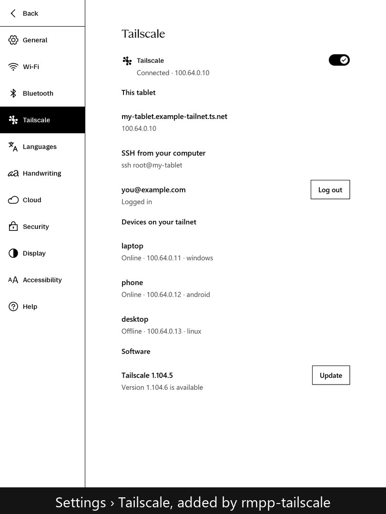

# rmpp-tailscale

*Settings › Tailscale: on/off, this tablet's address, SSH and your tailnet's devices (example data).*

[Tailscale](https://tailscale.com) for the reMarkable Paper Pro, with a **Settings > Tailscale** page:

- turn Tailscale on and off (stays that way across reboots)
- log in from the tablet: the page shows the login link as a **QR code** to scan with your phone
- status: device name, Tailscale IPs, account and tailnet, the other devices on your tailnet
- **SSH over Tailscale**: `ssh root@<tablet's Tailscale IP or MagicDNS name>` from anywhere on your tailnet
- check for and install Tailscale updates (`tailscale update`, signed packages from pkgs.tailscale.com)
- log out

Tested on OS 3.29 (Qt 6.10).

> Part of the **rmpp add-ons**, built on [rmpp-packages](https://github.com/lorancecall/rmpp-packages): it is
> installed by rmpp setup, loaded into xochitl at every boot by rmpp-preload (no xovi), and kept up to date with
> Vellum. How that differs from xovi: [how it works](https://github.com/lorancecall/rmpp-packages/blob/main/docs/how-it-works.md).

## Install

Install **rmpp setup** (desktop app or a one-line script) from
[rmpp-packages](https://github.com/lorancecall/rmpp-packages#install) and tick **rmpp-tailscale**.
It needs developer mode; the rmpp-packages page explains it.
Then open Settings > Tailscale, turn it on and scan the QR code. The binaries take about 70 MB in /home.
After a reMarkable OS update, press **Restore** in rmpp setup.

Other ways (Vellum on the command line, building and installing it yourself) and removal:
[docs/install.md](docs/install.md).

## How it works

- The Paper Pro kernel has no TUN driver, so `tailscaled` runs with `--tun=userspace-networking`.
  Other devices can reach the tablet; programs on the tablet reach the tailnet through the SOCKS5 proxy
  at `localhost:1055`.
- `rmpp-tailscaled.service` runs the official static arm64 binaries from `/home/root/.vellum/share/rmpp-tailscale`
  (the root file system is too small and read-only). State is in `/home/root/.local/share/rmpp-tailscale`.
  It only starts when `/home/root/.config/rmpp-tailscale/enabled` exists (the Settings toggle).
- reMarkable's SSH sockets listen on `wlan0`/`usb0` only; userspace Tailscale hands incoming connections
  to loopback, so `rmpp-tailscale-ssh.socket` adds the same dropbear server on `lo` (developer mode only).
- `librmpp-tailscale.so` is loaded into xochitl by `rmpp-preload` and injects the Settings row and page
  (QML in `qml/`, no moc: QML talks to C++ through a `QQmlPropertyMap`). It drives the `tailscale` CLI.
- `tailscale update` replaces the binaries in place; upgrading the package puts the packaged version back.

## Build

See [docs/install.md](docs/install.md#build-and-install-by-hand).

## License

GPL-3.0-only. `third_party/qrcodegen` is Project Nayuki's QR Code generator (MIT).
Tailscale is a trademark of Tailscale Inc.; this project is not affiliated with Tailscale.
