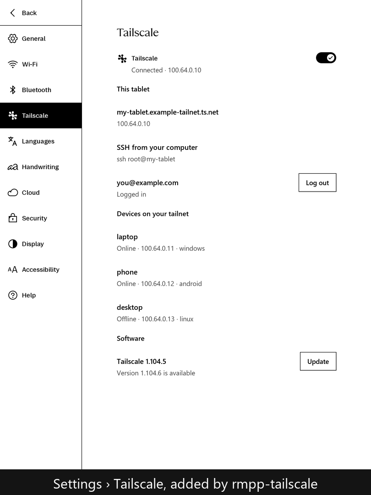

# rmpp-tailscale



*Settings › Tailscale: on/off, this tablet's address, SSH and your tailnet's devices (example data).*

[Tailscale](https://tailscale.com) for the reMarkable Paper Pro, with a **Settings > Tailscale** page:

- turn Tailscale on and off (stays that way across reboots)
- log in from the tablet: the page shows the login link as a **QR code** to scan with your phone
- status: device name, Tailscale IPs, account and tailnet, the other devices on your tailnet
- **SSH over Tailscale**: `ssh root@<tablet's Tailscale IP or MagicDNS name>` from anywhere on your tailnet
- check for and install Tailscale updates (`tailscale update`, signed packages from pkgs.tailscale.com)
- log out

Tested on OS 3.29 (Qt 6.10). Needs developer mode (for SSH) and [Vellum](https://github.com/vellum-dev/vellum).

## Install

With the rmpp package repository set up (see [rmpp-packages](https://github.com/lorancecall/rmpp-packages)):

```sh
vellum add rmpp-tailscale
```

Then open Settings > Tailscale, turn it on and scan the QR code.

## How it works

- The Paper Pro kernel has no TUN driver, so `tailscaled` runs with `--tun=userspace-networking`.
  Other devices can reach the tablet; programs on the tablet reach the tailnet through the SOCKS5 proxy
  at `localhost:1055`.
- `rmpp-tailscaled.service` runs the official static arm64 binaries from `/home/root/.vellum/share/rmpp-tailscale`
  (the root file system is too small and read-only). State is in `/home/root/.local/share/rmpp-tailscale`.
  It only starts when `/home/root/.config/rmpp-tailscale/enabled` exists (the Settings toggle).
- reMarkable's SSH sockets listen on `wlan0`/`usb0` only; userspace Tailscale hands incoming connections
  to loopback, so `rmpp-tailscale-ssh.socket` adds the same dropbear server on `lo` (developer mode only).
- `librmpp-tailscale.so` is loaded into xochitl by `rmpp-preload` and injects the Settings row and page
  (QML in `qml/`, no moc: QML talks to C++ through a `QQmlPropertyMap`). It drives the `tailscale` CLI.
- `tailscale update` replaces the binaries in place; upgrading the package puts the packaged version back.

## Build

```sh
./build.sh     # cross-build with ../sdk (Arm GNU aarch64 + Qt 6.10 headers + device libs)
./deploy.sh    # development only: copy to the tablet (ssh alias rmpp) and restart xochitl
```

The package recipe (VELBUILD, systemd units) is in
[rmpp-packages/packages/rmpp-tailscale](https://github.com/lorancecall/rmpp-packages/tree/main/packages/rmpp-tailscale).

## License

GPL-3.0-only. `third_party/qrcodegen` is Project Nayuki's QR Code generator (MIT).
Tailscale is a trademark of Tailscale Inc.; this project is not affiliated with Tailscale.
